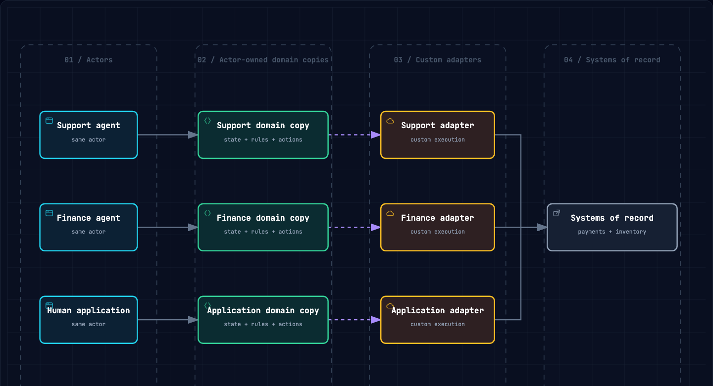
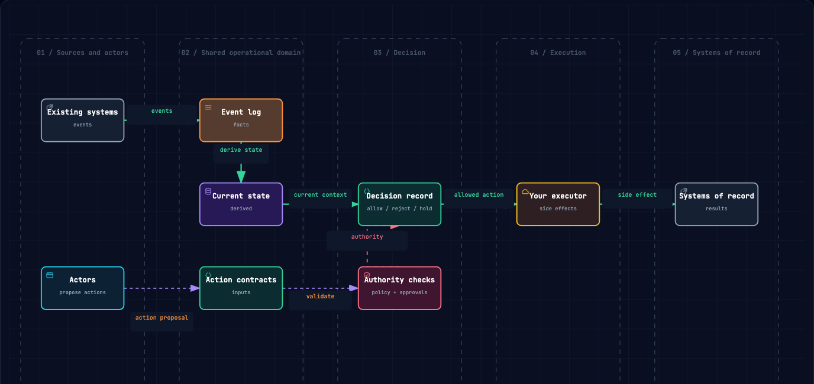

# Why KIFF

The first agent is usually a feature. The next few need a system.

An agent that drafts an answer or finds information can often live inside its
own application. The architecture changes when agents, people, and services all
need to work on the same order, case, invoice, account, or incident. That work
already has a lifecycle, valid next steps, and people with different authority.

Without a shared model, each new actor rebuilds those facts in its own prompts,
tool handlers, and integrations. Over time, the rules drift, state fragments,
and every new capability becomes another backend project.

## One Operational Truth

KIFF gives all of those actors one domain to work against.

```text
events -> shared state -> actions -> execution -> audit
```

The domain is yours. You define what an order, claim, mission, or account means.
KIFF supplies the mechanics that usually get rebuilt around it:

- events that record what happened
- state derived from those events
- typed action contracts with parameters, permissions, risk, and approvals
- executors that perform valid side effects
- decisions, execution results, and audit records that explain the outcome

This is not an integration hub that replaces your systems of record. Payment
providers, warehouses, internal services, and agent frameworks keep doing their
jobs. KIFF gives every participant the same answer to two operational questions:
what is true now, and what may happen next?

## The Same Contract for Every Actor

An agent proposes an action. A human application proposes an action. A service
or workflow proposes an action. They all meet the same action contract.

That matters when the result depends on live state rather than intent alone. A
refund may be allowed while an order is paid, require approval above a threshold,
and be refused once it has already been refunded. The rule belongs to the
domain, not to one agent's prompt or a single integration's handler.

Governance is therefore part of the operational model, not a bolt-on control.
KIFF evaluates the proposed action against current state, authority, parameters,
and approvals before the executor runs. Each of those is derived rather than
believed: state comes from the state machine and a caller that asserts a
different one is refused, authority resolves through the permission policy
rather than roles on the submitted actor, the approved bit is cleared and
re-read from the approval store, and the reviewer must differ from the
requester. That distinction — derived, not asserted — is the whole difference
between a gate and a suggestion. The result is recorded so the next
actor starts from the same reality.

## Why a Framework

Teams can assemble this themselves: a state machine, event store, permissions,
approval tables, action validation, execution records, and a way to replay an
entity later. They often do, then rebuild much of it when a second agent or a
new integration arrives.

KIFF provides those primitives as an idiomatic Go framework. It standardizes
the mechanics of coordination while leaving business semantics to the domain.
You can use the agent framework, transport, queue, workflow engine, and
database that fit your system.

## What KIFF Does Not Replace

KIFF is not a chatbot framework, model SDK, workflow engine, or generic web
framework. It does not own your prompts, systems of record, or business
vocabulary.

It starts when an actor wants to change shared operational state. A workflow
engine can schedule the work; KIFF determines whether the named action is valid
now. An executor performs the side effect; KIFF records the decision and result.

## Try It

Run the tour to see one domain shared by an agent and a human:

```bash
go run ./cmd/kiff-tour
```

Or scaffold a runnable example:

```bash
go install github.com/kiff/kiff/cmd/kiff@latest
kiff new -scenario refund github.com/acme/orders
cd orders
go mod tidy
make demo
```

The refund is only an example. The reusable result is the domain: its events,
state, actions, authority, execution boundary, and history are ready for every
actor that follows.

## Why the Authority Belongs Outside the Agent

Ask where an agent's limits are written down today and the answer is usually a
prompt, a config file, or a tool handler. Nobody responsible for the money can
read them, every change is a deploy, and every new agent writes its own copy.

KIFF keeps that authority outside the agent, in one domain that every actor
proposes against. The agent can be replaced; the rules for what it may do stay.
Every actor gets the same answers:

| Question | KIFF's answer |
| --- | --- |
| What happened? | Recorded events and execution outcomes |
| What is true now? | State derived from those events |
| What may happen next? | Named actions and valid transitions |
| Who may do it, and how much? | Permissions, approvals, and limits |
| Why did it happen? | One decision and audit history |

## When Every Agent Carries Its Own Rules

The first agent is usually a feature. The next few need a system.

When three actors join the same process, the common pattern is three backend
copies. Each owns an interpretation of state, rules, actions, and a custom path
into the same systems. That works in isolation. Together, those copies drift,
disagree, and multiply the coordination work.



## One Domain, Many Actors

The actors and systems do not change. KIFF replaces the repeated domain copies
with one operational domain and one validated execution path. Every actor sees
the same state, proposes the same named actions, and meets the same authority,
approval, and limit rules.

This does not replace your agent framework, HTTP stack, queue, cron job, or
systems of record. It evaluates proposed actions against current state before
your executor runs.



| Without KIFF | With KIFF | Practical effect |
| --- | --- | --- |
| Each actor carries its own version of state and rules. | Events and derived state are shared. | Actors stop disagreeing about what is true. |
| Every new actor builds another operational backend. | Actors propose the same named actions. | Add agents without rebuilding the operation. |
| Decisions and limits live in application code, prompts, and tool handlers. | One decision point evaluates every proposal. | Consistent approvals, limits, and refusals. |
| Logs are scattered across services. | Events, decisions, and results form one history. | Replay and explain an operational outcome. |
